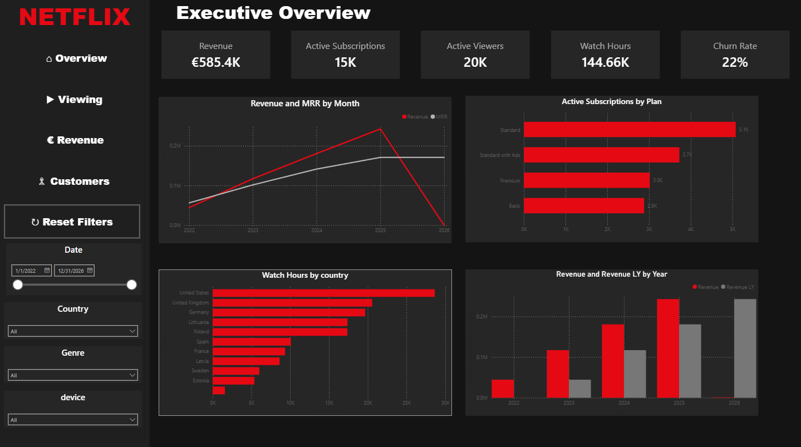
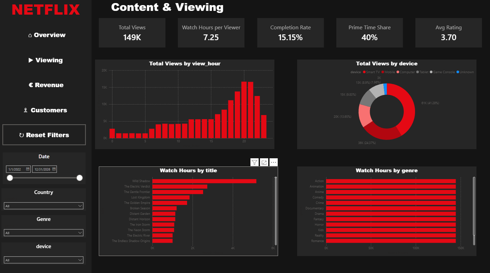
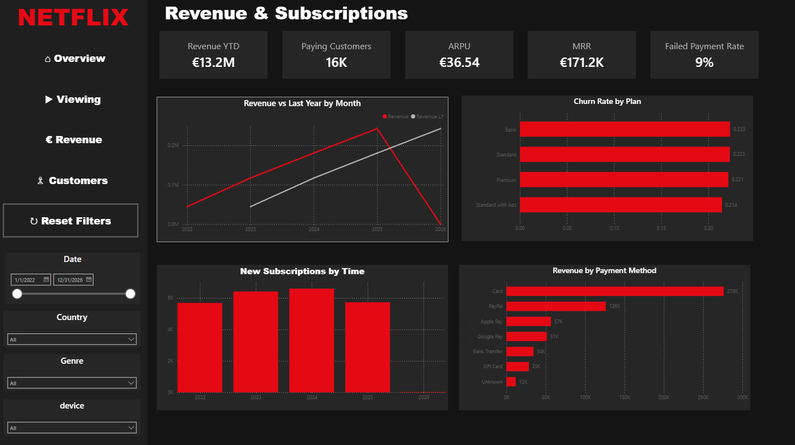
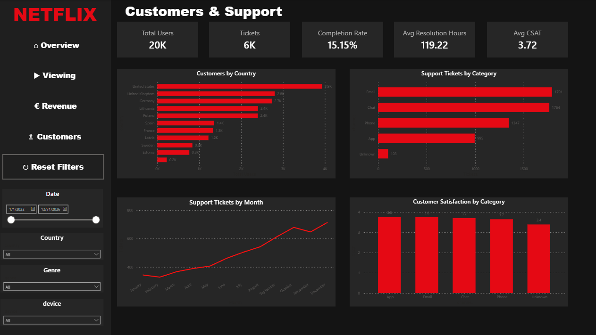
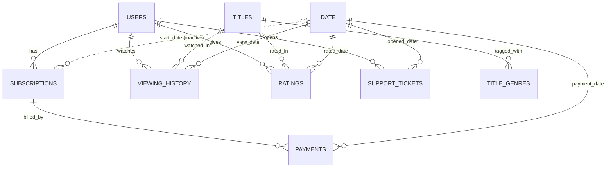

# Streaming Platform Performance Report

**2022–2025 · PostgreSQL · Power BI · DAX · Power Query**



---

## Company Overview

The company is a subscription video-on-demand platform serving 20,000 registered users in ten markets across Europe and North America. Its largest markets are the United States, the United Kingdom, Germany, Lithuania and Poland. The service is offered on four subscription tiers, Basic, Standard with Ads, Standard and Premium, priced from €5.99 to €18.99 per month with monthly and annual billing options. The catalogue contains 5,000 films and series across 14 genres, from Drama and Thriller to Kids, Anime and Documentary. Subscribers watch on Smart TVs, mobile devices, tablets, computers and game consoles.

Over the past four years the platform has grown from an early-stage service into an established regional business, with revenue increasing more than fivefold between 2022 and 2025. As growth in new subscriptions levels off, leadership's priorities have moved from acquisition to retention, monetisation and service quality. This analysis supports that shift. It examines how the business earns revenue, how subscribers engage with the content, where revenue and subscribers are lost, and how effectively the support organisation meets customer needs.

## Analytical Objectives

The analysis covers January 2022 to December 2025 and combines subscription, billing, viewing, ratings and customer-support data into one reporting model. It answers four sets of business questions:

- **Revenue:** how revenue has developed over time, which subscription tiers and payment channels contribute most, and how much is lost to failed payments and refunds.
- **Subscribers:** the size and value of the active subscriber base, measured through active subscriptions, monthly recurring revenue (MRR) and average revenue per user (ARPU), and how churn is distributed across tiers.
- **Engagement:** viewing behaviour by time of day, season, device, title and genre, and how audiences rate the catalogue.
- **Customer experience:** the geographic profile of the user base, the drivers of support demand, resolution times and customer satisfaction by channel.

The results are delivered as a four-page interactive Power BI report for executive and departmental stakeholders.

---

## Executive Summary

The business has delivered strong and consistent growth. Revenue rose from **€44.5K in 2022 to €242.9K in 2025**, a 5.5-fold increase over three years, for cumulative revenue of **€585.4K**. 2025 revenue was **34% higher** than in 2024. The paying subscriber base grew 4.5-fold over the same period, from **2,502 to 11,251**. At year-end 2025 the platform had **14,704 active subscriptions** generating **€171.2K in monthly recurring revenue**, and average revenue per paying user over the period was **€36.54**.

Engagement is a clear strength. Almost every registered user (19,951 of 20,000) streamed content during the period, averaging **7.25 watch hours per viewer**. Viewing is concentrated in the evening, with a peak at 20:00, and Smart TVs are the main device, accounting for **41%** of all sessions. The two most significant risks are a **churn rate of 22% that is almost identical across every tier**, and a **payment failure rate of 9%**. Together they limit the return on acquisition spending and leave recoverable revenue unclaimed. Customer satisfaction is moderate at **3.72 out of 5**, and the average resolution time of five days is the main opportunity for operational improvement.

| KPI | Value |
|---|---|
| Cumulative revenue (2022–2025) | €585.4K |
| Revenue growth, 2025 vs 2024 | +34% |
| Active subscriptions (year-end 2025) | 14,704 |
| Monthly recurring revenue (year-end 2025) | €171.2K |
| Average revenue per paying user | €36.54 |
| Churn rate | 22.0% |
| Total watch hours | 144.7K |
| Average content rating | 3.70 / 5 |
| Customer satisfaction (CSAT) | 3.72 / 5 |

---

## Insights Deep-Dive

### 1. Executive Overview


Revenue increased in every year of the period, from €44.5K in 2022 to €117.2K in 2023, €180.7K in 2024 and €242.9K in 2025. Year-on-year growth slowed from 163% to 34% as the business matured, which is expected for a subscription service moving beyond its launch phase. Growth came mainly from subscriber acquisition: the number of paying subscribers grew 4.5-fold while revenue grew 5.5-fold, so the gain in revenue per subscriber was modest. Monthly recurring revenue followed the same path and reached €171.2K at the end of 2025, which gives a solid base of predictable income for the coming year.

Standard is the commercial core of the business, generating 40% of revenue and holding the largest share of active subscriptions. Premium follows with 33% of revenue. Basic and Standard with Ads together contribute 27%, and they serve mainly as entry points for price-sensitive customers. Geographically, the United States is the largest market by both subscribers and watch hours, followed by the United Kingdom, Germany and Lithuania. Revenue is spread across several markets, which reduces dependence on any single country.

### 2. Content and Viewing



Viewing follows a clear daily and seasonal rhythm. Activity is low overnight, rises gradually through the day and peaks between 19:00 and 22:00, a window that accounts for 40% of all sessions. December is the busiest month of the year, with roughly twice as many sessions as March, the quietest month. The platform is consumed mainly on the large screen: Smart TVs account for 41% of sessions, followed by mobile devices at 24% and computers at 14%. This supports investment in TV app experience and high-definition delivery.

Consumption is highly concentrated. The top 10% of titles generate 59% of all watch hours, and the 50 most-watched titles alone account for 28%. A small group of hits carries a large share of engagement, while much of the catalogue is under-used. Drama, Horror and Kids are the most-watched genres. Audiences respond well to the content, with an average rating of 3.70 out of 5 and 76% of thumbs ratings positive. The full-completion rate of 15% reflects how much of the catalogue is series content, which is usually watched across several sessions.

### 3. Revenue and Subscriptions



Churn is the most important structural issue facing the business. About 22% of subscriptions end in cancellation or churn, and the rate is remarkably uniform across tiers, ranging only from 21.4% for Standard with Ads to 22.3% for Basic and Standard. Premium subscribers, who pay more than three times the Standard with Ads price, leave at the same rate as subscribers on the cheapest tiers. This strongly suggests that price is not the main driver of attrition, and that the causes lie in engagement, billing or service experience. At the same time, new subscriptions have levelled off at between 5,700 and 6,600 a year, so future revenue growth depends increasingly on keeping existing subscribers.

Revenue leakage through the billing process is significant. Of all payment attempts, 8.9% fail, and refunds over the period totalled €20.1K, equal to 3.4% of revenue. Card payments are the dominant channel at 47% of revenue, followed by PayPal at 22% and the digital wallets Apple Pay and Google Pay at 10% and 9%. Bank transfers and gift cards play only a minor role. Improving payment success rates is one of the quickest ways to increase revenue without spending more on acquisition.

### 4. Customers and Support



The support organisation handled 6,000 cases over the period, about 30 for every 100 registered users. Playback issues (25%), account access (23%) and billing (22%) are the leading reasons for contact. Billing cases are directly linked to the payment failure rate noted above, so fixing payment problems should also reduce support volume. Ticket volume rises steadily through the year, in line with the seasonal growth in viewing, and support capacity should be planned for the fourth-quarter peak.

Service performance is the clearest area for operational improvement. The average resolution time is 119 hours, almost five days, and 1,801 cases remain open, in progress or escalated. Customer satisfaction averages 3.72 out of 5. Email and in-app support achieve the highest scores at 3.76, and phone support scores lowest at 3.65. This suggests that written, self-service channels resolve issues more effectively than phone support and could take on a larger share of contact volume.

---

## Recommendations

**Recover revenue lost in billing.** The 9% payment failure rate represents meaningful revenue that can be recovered. Automated retry logic for failed card payments, notifications before cards expire, and wider use of digital wallets should be introduced together. Recovering half of all failed attempts would increase revenue by roughly 5%, with little additional cost.

**Move retention strategy beyond price.** Churn is consistent across all tiers, so discounts alone are unlikely to reduce attrition. The business should build a churn-risk score from behavioural signals, such as falling viewing activity, repeated payment failures and unresolved support cases, and act on at-risk subscribers before they cancel. Promoting annual billing at a discount before the lower-engagement spring period would further strengthen commitment.

**Grow revenue per subscriber.** Premium carries no additional churn risk compared with Standard, so encouraging Standard subscribers to upgrade, for example through time-limited Premium trials during peak viewing months, offers a low-risk way to increase ARPU.

**Align content and release planning with demand.** Major releases should be scheduled for weekday evenings and the fourth quarter, when audiences are largest. Personalised recommendations should be strengthened to surface titles beyond the top 10%, which would make more use of the existing catalogue and reduce dependence on a few hits. Drama, Horror and Kids content should be prioritised in acquisition and production.

**Raise service standards in support.** The business should set a target average resolution time below 48 hours, starting with playback and account-access cases, which make up almost half of all demand. Moving contact volume towards email and in-app support, which deliver higher satisfaction than phone, would improve both efficiency and customer experience.

---

## Interactive Dashboard

The Power BI report has four pages, each aimed at a specific group of stakeholders:

| Page | Purpose |
|---|---|
| **Executive Overview** | Company-wide performance at a glance: revenue, active subscriptions, active viewers, watch hours and churn, with revenue and MRR trends and the distribution by tier and market |
| **Content & Viewing** | Engagement analysis by hour, device, title and genre, together with completion rate, prime-time share and average rating |
| **Revenue & Subscriptions** | Financial and subscriber performance: paying customers, ARPU, MRR, payment failure rate, churn by tier, new subscriptions and revenue by payment method |
| **Customers & Support** | The user base by country, support demand by channel and over time, resolution performance and customer satisfaction |

Users move between pages with a navigation panel on the left. Date, Country, Genre and Device slicers are synchronised across all four pages, so a selection made on one page carries through the whole report, and a reset control returns the report to its default view. The visual design uses a dark theme with a single accent colour, which keeps attention on the data.

---

## Data Preparation and Methodology

### Data Cleaning in PostgreSQL

The analysis is built on eight source tables with a total of 302,178 records. Before any analysis, the data was loaded into **PostgreSQL** and taken through a structured, reproducible cleaning pipeline. The raw files were first loaded into a staging schema with every field stored as text, so that no record was rejected on import. A dedicated cleaning script then standardised, validated and typed each table into a separate `clean` schema. Six reusable SQL functions handle the repeated transformations consistently across all tables: converting placeholder values to NULL, parsing seven date and timestamp formats, converting monetary values stored as text, standardising boolean values, normalising identifiers and mapping country names to a single standard.

The cleaning process removed 2,710 duplicate records and enforced a primary key on every cleaned table. It also removed records that referred to titles or subscriptions not present in the master tables, and resolved inconsistent category labels, such as different spellings of countries, plans, genres and statuses, into single standard values. Free-text measurements were converted into analytical fields: viewing time recorded in mixed units became minutes, ratings recorded on different scales became a consistent 1–5 score, and title duration was split into film length and number of series seasons. Values outside plausible ranges, such as negative amounts or extreme viewing durations, were set to NULL rather than deleted, so that the rest of each record was kept. Logical inconsistencies, such as subscription end dates earlier than start dates, were flagged for review. The cleaned tables were then exported to CSV for use in Power BI.

| Step | File | Purpose |
|---|---|---|
| 1 | `SQL/00_create_database.sql` | Creates the `streaming` database |
| 2 | `SQL/01_load_raw.sql` | Loads the source files into a `raw` staging schema |
| 3 | `SQL/02_clean.sql` | Cleans, standardises and types each table into the `clean` schema, then validates row counts |
| 4 | `SQL/03_export_clean.sql` | Exports the cleaned tables to `clean_data/` |
| 5 | `Netflix.pbix` | Holds the Power Query typing, data model, DAX measures and report pages |

### Data Model

The reporting model is a star schema of eight tables plus a dedicated Date dimension. `users` and `titles` are the primary dimensions, `viewing_history` and `payments` are the largest fact tables, and `subscriptions` links subscribers to their billing history. All relationships filter in one direction. The relationship between the Date table and subscription start dates is kept inactive and activated within specific measures, so the Date table doesn't reach `payments` along two paths.



| Table | Rows | Grain |
|---|---|---|
| users | 20,000 | One row per registered user |
| titles | 5,000 | One row per film or series |
| title_genres | 9,462 | One row per title–genre pair |
| subscriptions | 24,426 | One row per subscription period |
| payments | 60,000 | One row per payment attempt |
| viewing_history | 148,806 | One row per viewing session |
| ratings | 24,897 | One row per user rating |
| support_tickets | 6,000 | One row per support case |

### DAX Measures

The report uses 35 DAX measures held in a dedicated `_Measures` table and organised into display folders by subject area. They were deployed through a TMDL script. Most measures are straightforward aggregations. Others use more advanced patterns:

- **Time intelligence** for year-to-date and prior-year comparisons.
- **`USERELATIONSHIP`** to analyse new subscriptions by start date through the inactive relationship.
- **`TREATAS`** to filter user signups by date without a physical relationship.
- **Point-in-time logic** for active subscriptions and MRR, which counts the subscriptions active on the last day of the selected period:

```DAX
MRR =
VAR AsOf = MAX ( 'Date'[Date] )
RETURN
    CALCULATE (
        SUM ( subscriptions[monthly_price] ),
        subscriptions[start_date] <= AsOf,
        OR ( ISBLANK ( subscriptions[end_date] ), subscriptions[end_date] > AsOf ),
        subscriptions[end_date_invalid] = FALSE ()
    )
```

### How to Run

1. Install **PostgreSQL 16 or later** and make sure `psql` is on the system PATH.
2. From the project root, run:
   ```cmd
   psql -U postgres -d postgres  -f SQL/00_create_database.sql
   psql -U postgres -d streaming -f SQL/01_load_raw.sql
   psql -U postgres -d streaming -f SQL/02_clean.sql
   psql -U postgres -d streaming -f SQL/03_export_clean.sql
   ```
3. Open `Netflix.pbix` in Power BI Desktop. Update the file path under **Transform data → Data source settings** if required, then select **Refresh**.

### Project Structure

```
Netflix/
├── data/                         # Source CSV files (8 tables)
├── clean_data/                   # Cleaned CSV exports from PostgreSQL
├── SQL/
│   ├── 00_create_database.sql
│   ├── 01_load_raw.sql
│   ├── 02_clean.sql
│   └── 03_export_clean.sql
├── images/                       # Report screenshots used in this README
├── Netflix.pbix
└── README.md
```

---

## Author

**Algirdas Vailionis**, Data Analyst
[GitHub](https://github.com/imalgirdas)

<sub>Netflix branding is used as a visual theme only. This project is not affiliated with or endorsed by Netflix, Inc.</sub>
